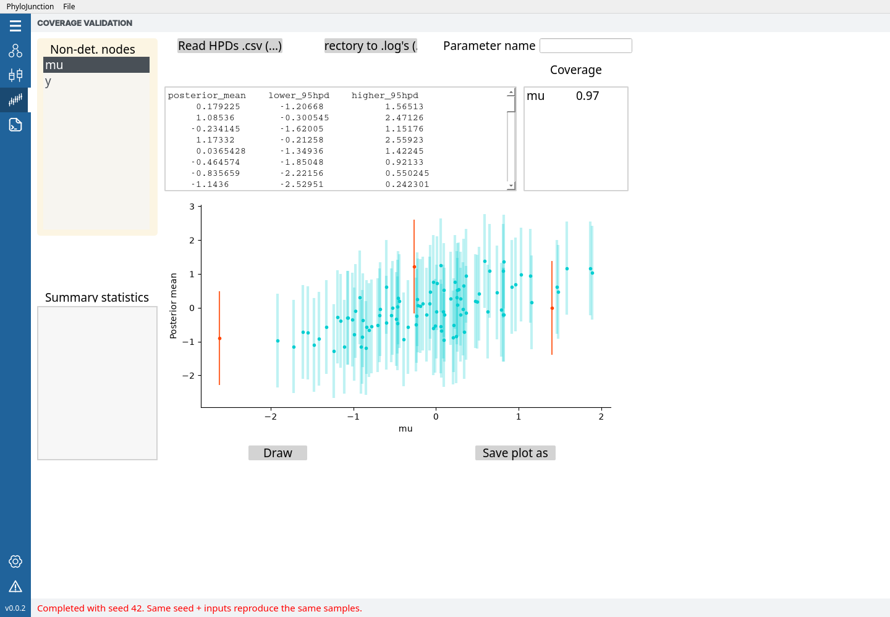

%%%%%%%%%%%%%
Documentation
%%%%%%%%%%%%%

.. contents::
    :local:
    :backlinks: none

--------
Overview
--------

Origins and design
==================

The |pj| project was born from our need to simulate arbitrarily complex SSE processes, but not being able to do so with many existing applications.
A series of related diversification models had been implemented in excellent computational methods, but each of those tools made unique modeling assumptions that we wanted to relax.

Instead of reverse-engineering and modifying code written by others, however, it seemed like the path of least resistance was to write our own simulator.
We also realized that our program could potentially come in handy in multiple projects, current and future, though only if written as more than a "one-off" chunk of code.

Ideally, |pj| would have to be "modular" in its architecture, both in terms of its codebase as well as how models should be represented and specified.
This modularity would allow future models to be more easily implemented -- potentially by other developers -- and seamlessly patched into |pj|.

With the above in mind, we reasoned our work would be more likely to bear fruits (and faster) if we used a programming language that:
    
    (i) was easy to prototype and debug model code in, and
    (ii) cross-platform,
    (iii) supported object-oriented programming, and for which
    (iv) biology and data-science libraries were available.

Python was our language of choice.
As for item (4), for example, we could make heavy use of the great `Dendropy <https://dendropy.org/>`_ library, maintained by Jeet Sukumaran and collaborators.

Modularity was achieved by building |pj| around a graphical modeling architecture.
This design (used in the past, see below) would not only make |pj| a more flexible simulator, but also more generally useful in the future, as a tool for method development and inference.

Graphical models
================

|pj| follows the graphical model paradigm popularized in the last decade by programs like `RevBayes <https://revbayes.github.io/>`__, `BEAST <https://beast.community/>`__ and `BEAST 2 <https://www.beast2.org/>`__.
In what follows, we shall offer just a brief refresher on what probabilistic graphical models are, and one simple example of their use in evolutionary modeling.
Those interested in a more detailed exposition will find it in Höhna et al. (2014) and references therein (also, take a look `here <https://revbayes.github.io/tutorials/intro/graph_models.html>`_).

Just as with the RevBayes and BEAST programs, specifying a model in |pj| amounts to writing down any number of conditional dependencies among random variables.
When looked at collectively, random variables comprise a type of probabilistic graphical model called a Bayesian network.
As the name suggest, such models can be described as graphs -- directed acyclic graphs (**DAG**), more specifically -- where each node (or vertex) represents a random variable, and each edge a conditional dependency between the two nodes (variables) it connects.

A Bayesian network representing a very simple model can be seen in figure 1a:

..  figure:: ../images/simple_graphical_model_both_manual.png
    :figwidth: 100%
    :scale: 40%
    :align: center

    **Figure 1.** A simple probabilistic model represented by (a) a Bayesian network, and (b) a factor graph.
    From the notation in the main text, :math:`\theta=\{sd, m\}`.
    The dashed box is called a "plate", and for each node it envelops it denotes multiple (in this case, precisely five) i.i.d. random variables.
    White and gray nodes denote random variables whose values we do (i.e., data) and do not know (i.e., parameters), respectively.

If we were to pen down what this Bayesian network represents in probability terms, we would arrive at a joint density (assuming continuous variables) given by expression:

.. math::
    :label: jointprob

    f_{\Theta,D}(\theta,d) = f_{\Theta|D}(\theta|D=d)f_D(d) = f_{D|\Theta}(d|\Theta=\theta)f_\Theta(\theta),

where :math:`\theta=\{sd, m\}`.

By comparing the Bayesian network graph and the expression above, the attentive reader will notice that functions are not represented in the graph.
We do not know exactly how random variables are related, other than :math:`d_1` through :math:`d_5` depending somehow on :math:`sd` and :math:`m`.
This is why it can be helpful to adopt a more general graphical representation: a factor graph (Fig. 1b).

The model underlying the factor graph in figure 1b is the same as that shown by the Bayesian network, the main difference being the additional factor nodes (the filled squares).
Factor nodes can make the relationships between two or more random variables more explicit, especially if their (factor) functions are annotated.

In the example above we can see a factor whose function :math:`f_{D|\Theta}(d|\Theta=\theta)` gives us the probability of :math:`\boldsymbol{d} = \{d_i: 1 \leq i \leq n\}` given :math:`\theta`.
It is annotated as "Normal", so we in fact know a close-form expression for this factor function; it is the probability density function of a normal distribution.
Random variables :math:`sd` and :math:`m` stand for the standard deviation and the mean of that normal distribution.
(For those curious to see just how complicated factor graphs can be, an example can be found in Zhang et al., 2023; see their Supplementary Fig. X.)

How to read a DAG?
------------------

Most biologists specifying a DAG on a computer do so as the first step of statistical **inference**.
They are interested in estimating unknown quantities about the natural world.
These quantities -- the random variables! -- whose values we do not know (but would like to estimate) are referred to as the **parameters** of the model.
Of course, parameter estimation requires that we know the value(s) of one or more random variables, which we naturally refer to as **data**.

In the example in figure 1, the parameters are :math:`sd` and :math:`m`, jointly referred to as :math:`\theta`; the data is node labeled :math:`d_i`.
(Note how they are colored differently, gray for data, white for parameter.)
Carrying out statistical inference thus implies reading the DAG from its data nodes, normally at the bottom, towards the parameter nodes above.

The most natural approach to parameter estimation requires that we simply take the middle and right-hand side terms in equation :eq:`jointprob`,
and solve for :math:`f_{\Theta|D}(\theta|D=d)`, the posterior density function:

.. math::
    :label: bayestheorem

    f_{\Theta|D}(\theta|D=d) = \frac{f_{D|\Theta}(d|\Theta=\theta)f_\Theta(\theta)}{f_D(d)}

This expression is known as Bayes theorem.
What programs like RevBayes, BEAST and BEAST 2 do is evaluate the posterior density function at several values of :math:`\theta`, and output the resulting (posterior) distribution.

----

|pj|, however, is among other things a collection of **simulation** (rather than estimation) engines.
Borrowing the jargon used above, we are primarily interested in generating values for random variables, some of which are parameters, some data.

Here, it makes sense to think of factors as the distributions from which values will be sampled (though as we will see below, factors can also represent deterministic functions).
As opposed to estimation, simulation starts at the top (or "outer") layers of the DAG, from parameters whose values we do know, and flows in the direction pointed to by arrows (normally downwards; Fig. 1b).

In figure 1b, for example, we start from known values for the parameters of the distributions at the top.
The exponential distribution from which we sample (i.e., simulate) :math:`sd` has a rate of 1.0; the standard normal distribution (:math:`Z`) from which we sample :math:`m`, by definition, has a mean of 0.0 and a standard deviation of 1.0.
We then define a normal distribution from the sampled values of :math:`sd` and :math:`m`, and in turn sample five times from that normal distribution, obtaining our data values in :math:`\boldsymbol{d}`.

Specifying a model (an example)
===============================

|pj| takes a model specification approach that sits between those adopted by the BEAST and RevBayes communities, and that largely intersects with the `LinguaPhylo <https://linguaphylo.github.io/>`_ project.
DAG-building instructions in |pj| are written in its own programming language, *phylojunction* (written in lowercase), whose syntax evokes RevBayes' Rev language.
But unlike Rev, *phylojunction* is not a fully fledged scripting language; it is lightweight and behaves more like a markup language such as XML, BEAST's format of choice.

Commands in *phylojunction* can be read as mathematical statements, and are naturally interpreted as instructions for building a node in a DAG.
Here is what a series of those commands would look like if written as a *phylojunction* script:

.. code-block:: 
    :caption: **Example script 1.** Script written in *phylojunction* specifying a time-homogenous birth-death model.

    # hyperprior
    m <- 0.0 # mean of log birth rate
    sd <- 0.1 # standard deviation of log birth rate
    
    # rate values
    d <- 1.0 # death
    b ~ lognormal(meanlog=m, sdlog=sd) # birth
    
    # deterministic rate containers
    dr := sse_rate(name="death_rate", value=d, event="extinction")
    br := sse_rate(name="birth_rate", value=b, event="speciation")
    
    O <- 2.0 # origin age
    
    # deterministic parameter stash
    s := sse_stash(flat_rate_mat=[dr, br], n_states=1, n_epochs=1) # parameter stash

    # phylogenetic tree
    T ~ discrete_sse(stash=s, stop="age", stop_value=O, origin="true")

Each line in the above script is a command instructing the application engine to take some form of user input, produce some value from it, and then store that value permanently in a new variable created on the spot.

Every command string consists of an assignment operator (e.g., ``<-``, ``:=``, ``~``) placed between the variable being created (on its left side) and some user input (on its right side).
We can look at some of these commands individually:

* ``d <- 1.0`` creates a variable ``d`` (the death rate) that is then passed and henceforth stores constant value ``1.0``. We use ``<-`` when we know the value of a random variable and want to create a constant node in the DAG;
* ``b ~ lognormal(meanlog=m, sdlog=sd)`` creates a variable ``b`` (the birth rate) that will store a random value drawn from a user-specified distribution. The logarithm of the birth rate is normal with mean ``m`` and standard deviation ``sd``.
* ``dr := sse_rate(name="death_rate", value=d, event="extinction")`` calls deterministic function ``sse_rate``, which creates variable ``dr`` from the value stored in ``d`` and some other user input. There is no stochasticity to deterministic assignments; they help make explicit steps where variables are transformed, annotated or combined with others.

And this is the DAG such script instantiates:

..  figure:: ../images/bd_graphical_model_manual.png
    :figwidth: 100%
    :scale: 40%
    :align: center

    **Figure 2.** Factor graph representing the time-homogenous birth-death model specified in example script 1.

Note how this DAG has a factor node characterized by a different type of function: deterministic function ``sse_rate``.
Such functions are denoted by filled diamonds instead of filled squares (those represent distributions), and will have their output enclosed in a hollow diamond.

.. _executions:

Complete executions and IID vectors
-----------------------------------

A complete execution evaluates the model once, in statement order. Repeat the entire model
with ``pjcli model.pj --runs 10``, or set **Executions** in GUI Settings before loading a script.
Each execution draws fresh values for the stochastic variables.

Within an execution, ``iid`` draws independent observations with shared distribution parameters,
as in the plated node in figure 1:

.. code-block:: text
    :caption: **Example script 2.** Five IID observations per complete execution.

    sd ~ exponential(rate=1)
    m ~ normal(mean=0.0, sd=1.0)
    d ~ iid(5, normal(mean=m, sd=sd))

Ten executions produce ten pairs of ``m`` and ``sd``, each with five observations in ``d``.
Assign constants to ``m`` and ``sd`` to hold the parameters fixed across executions.
Within a script, ``d[1]`` selects the first observation; indices start at one.
Nested vectors retain their structure: ``x[i][j]`` selects element ``j`` of vector ``x[i]``.

Assignments and named distributions
^^^^^^^^^^^^^^^^^^^^^^^^^^^^^^^^^^^

A distribution can be named and reused: ``prior := normal(0, 1)`` constructs it, and
``x ~ prior`` draws a value. Construction alone draws nothing.
Reassigning a name affects later statements without recomputing earlier values.
A complete rerun evaluates the whole script again.
Commands entered interactively apply to every existing execution; if any execution fails,
the command leaves the model and its values unchanged.

.. _vectorization:

Vectorization and comprehensions
^^^^^^^^^^^^^^^^^^^^^^^^^^^^^^^^

A function expecting a scalar argument can instead receive a list, producing one result per
entry. Scalar arguments are shared; multiple list arguments are paired and must have equal
lengths. A one-element list is not a scalar. Functions that accept lists consume them intact:
for example, ``categorical([1,2], [1,1])`` constructs one distribution.

.. code-block:: text

    mus <- [0,2]
    sds <- [1,3]
    distributions := normal(mus,sds)
    xs ~ distributions
    ys ~ [normal(mu,sd) for (mu,sd) in zip_strict(mus,sds)]

Both ``xs`` and ``ys`` contain two independent normal draws, with means 0 and 2 and standard
deviations 1 and 3, respectively. The two statements make separate draws.
``zip_strict`` pairs corresponding entries and rejects unequal lengths.

Vectorization handles one level. Use nested comprehensions for nested lists:

.. code-block:: text

    means <- [[0],[1,2]]
    values ~ [[normal(mu,1) for mu in row] for row in means]

Here ``values`` contains a one-element list followed by a two-element list.
``~`` samples each distribution in a nested list, preserving the nesting.
Lists used with ``~`` must contain only distributions or lists of distributions.

Comprehensions accept list iterables and bind local names, including flat tuple unpacking as
above. Use nested comprehensions for multiple levels; filters and multiple ``for`` clauses in
one comprehension are not supported. Each statement must occupy one line.
Ordinary lists must have compatible element types and nesting; integers and reals may mix,
and inner lists may differ in length. Empty lists are allowed.

------------------------------
Graphical user interface (GUI)
------------------------------

.. _GUI:

|pj| comes with a (simple!) graphical user interface (GUI; see Fig. 3) that allows users to incrementally build a model while simultaneously inspecting any simulation output (among other things).

..  figure:: ../images/pjgui_model.png
    :figwidth: 100%
    :align: center

    **Figure 3.** |pj|'s GUI main window.

Like any modern computer application, |pj|'s GUI exposes its features to users via a menu (Fig. 3, number 2).
On the main tab ("Model"), one can build a model (DAG) with commands entered in the prompt (Fig. 3, number 1), or by loading a *phylojunction* script or a model from a previous |pj| section.
The latter can be done by clicking the application's menu (top-left corner of the Desktop on Apple machines), and clicking "File > Read script" or "File > Load model".
Model building commands can be revisited by going into the menu's "Command log" tab.
Saved models from the older value-bearing DAG format cannot be loaded; load their PJ scripts instead.

.. warning::
    If mistakes are made when entering a command, |pj| will flash a "Warning produced" message in red, at the bottom of the main window.
    The warning message can be seen by visiting the "Warnings" tab.

Given a model, DAG node values can be navigated as a plot, text string, or both (Fig. 3, numbers 3 and 4).
Users can select an execution and a vector element to inspect its value or plot.
A selected tree shows its individual statistics, such as root age and tip count.
Across executions, numeric values and tree statistics receive means and standard deviations.
Vector summaries compare corresponding elements across executions; they do not average elements
within a vector. Vectors whose shapes vary between executions have no aggregate summary.
The screenshot uses older control labels.

After a model is specified, saving the main plot (from the "Model" tab) to disk can be done by clicking "Save plot as".
Simulated data tables, or the model itself, in turn, can be saved to disk by clicking the application menu (top menu), and clicking "File > Save data as" or "File > Save model as".

Implementation comparison
=========================

The "Compare" tab (under "Model") streamlines the comparison of |pj|'s simulations with those from an external simulator, with respect to a summary statistic.
There are two main moments when carrying out this type of comparison may be useful or required.
The first is when a model is being first implemented in |pj|, and there happens to exist an independent implementation elsewhere.
This latter implementation can be used to provide a baseline expectation for |pj|.

Beyond model development within the platform, the "Compare" tab was further designed to expedite activities related to teaching.
Students in an evolutionary modeling course may be asked to code their own Yule model, for example, in whatever programming language.
After Yule trees are obtained, all they need to do is collect summary statistics that are also monitored by |pj| (e.g., the root age), and upload them into the "Compare" tab.
|pj| then automatically plots the two distributions (one from the student, one from |pj| itself) side by side, revealing if implementations behave similarly.

In **Settings**, set **Executions** to 10, then use **File > Read script** to load
``examples/multiple_scalar_tree_plated.pj``. Its ``rv5`` variable holds two normal observations
per execution; ``trs2`` holds two trees. Compare one component across executions at a time.

In **Compare**, click **Compare to .csv (...)** and load
``examples/compare_files/comparison_multiple_scalar_tree_plated_rv5.csv``.
Select ``rv5[1]`` from **Node to compare**, then click **Draw**.
The CSV's value column must match the selected component name, here ``rv5[1]``.
It also contains ``program``, ``sample``, and ``replicate`` columns identifying the external
observations. The plot compares the two sets of normal draws; small samples can differ visibly.

.. figure:: ../images/pjgui_compare.png
    :figwidth: 100%
    :align: center

    **Figure 4.** Comparing a scalar variable in the GUI. This screenshot uses older node labels.

To compare trees, select ``trs2[1]`` and choose ``root_age`` under **Summary statistics**.
Load ``examples/compare_files/comparison_multiple_scalar_tree_plated_trs2.csv`` and click
**Draw**. For trees, the CSV column must match the selected statistic rather than the node name.

Coverage validation
===================

Coverage measures how often posterior intervals contain the true parameter used to simulate
each dataset. Across repeated draws from the prior and model, a 95% posterior interval should
contain the true value about 95% of the time. Finite samples vary; coverage alone does not prove
an implementation correct.

This example uses exact normal posterior intervals to demonstrate the GUI without an external
inference program. From the repository root, run:

.. code-block:: bash

    python examples/coverage_files/prepare_normal.py

The preparation script executes this model 100 times with seed 42 and writes ``normal.csv``
in the same directory:

.. literalinclude:: ../../../examples/coverage_files/normal.pj
   :language: text

For this model, the posterior of ``mu`` has mean ``y / 2`` and variance ``1 / 2``.
The CSV contains its mean and 95% HPD limits for each execution, in execution order.

1. In **Settings**, set **Executions** to 100 and **Random seed** to 42.
2. Use **File > Read script** to load ``examples/coverage_files/normal.pj``.
3. In **Coverage**, select ``mu`` under **Non-det. nodes**.
4. Click **Read HPDs .csv (...)**, load ``examples/coverage_files/normal.csv``, then click **Draw**.

    **Figure 5.** Exact normal posterior intervals compared with the simulated values of ``mu``.

The horizontal axis shows true parameter values; the vertical axis shows posterior means.
Blue intervals contain the true value and red intervals miss it. The top-right panel gives
the fraction containing the truth.

For your own analysis, supply one CSV row per execution, in the same order, with columns
``posterior_mean``, ``lower_95hpd``, and ``higher_95hpd``. Select a scalar parameter or a fixed
vector component such as ``mu[1]``. Each component contributes one value per execution.
Changing the model, seed, or execution count requires matching posterior summaries.

Alternatively, use **Directory to .log's (...)** to compute summaries from posterior samples.
Supply one tab-separated ``.log`` file per execution, named in execution order (for example,
``run1.log``, ``run2.log``, …). Set **Parameter name in .log** if its column name differs from
the selected parameter. The GUI uses all rows; remove burn-in samples before loading the files.

----------------------------
Command-line interface (CLI)
----------------------------

.. _CLI:

|pj| has a command-line interface (CLI) as an entry point for some of its functionalities -- it is particularly handy when running |pj| is a step in a longer pipeline (perhaps being run on a cluster).
The easiest way to see what is possible with the CLI is to call it on the Terminal with the ``-h`` flag, like so:

.. code-block:: bash

    pjcli -h

The help message should list a series of flags, which we expand on below:

    | ``--runs``: Number of complete model executions (default: 1).
    | ``--output-format``: ``separate-csv`` (default), ``combined-csv``, or ``json``; see :ref:`output-formats`.
    | ``-d``: Simulated data tables are written to disk.
    | ``-f``: Plots for the selected DAG nodes (whose names and execution ranges are passed as arguments) are written to disk. The argument for ``-f`` should be passed within single-quotes, e.g., 'birth_rate,trs;1-2,1-10'.
    | ``-o``: Directory where to place simulated data tables and figures.
    | ``-p``: Prefix to prepend output files with (e.g., "simulation1")
    | ``-nex``: Certain simulated data is written to disk in NEXUS format.
    | ``-r``: Random seed so that simulations always produce the same output.

Note that if no argument is passed to ``-o``, data tables written to disk (prompted by ``-d``) will be placed in the directory from which PhyloJunction is called.
Figures (prompted by ``-f``), in turn, will be placed in a "figures/" sub-directory, next to the data tables. 

.. _output-formats:

--------------
Exporting data
--------------

Use ``pjcli model.pj --runs 10 -d -o output`` to save simulated values, or select an output
format in the GUI before saving data. The CLI ``--output-format`` choices are:

* ``separate-csv`` (default): one CSV per variable, with ``@execution`` and ``@element``
  identifying the execution and vector element. Both use one-based indices; nested element
  paths look like ``[2][1]``. Scalars have an empty element path.
* ``combined-csv``: one execution per row, with columns such as ``x[1]`` and ``x[2][1]``.
  Each variable must retain its full vector shape across executions. Empty vectors appear
  as ``[]``.
* ``json``: a ``samples.mcon`` file with an MCON 0.2 header followed by one JSON object per
  execution, in execution order. This format preserves nested vectors of changing lengths.

The GUI labels these formats **Separate files (CSV)**, **Combined (CSV)**, and **JSON (MCON)**.
Exports include simulated and assigned values; distributions and other model-construction objects are omitted.
Trees appear as annotated Newick strings, with additional files for tree statistics, traits,
and fossils. Stochastic maps can be saved separately.

-------------------------
RevBayes inference export
-------------------------

Export a simulated model to estimate its parameters in RevBayes. Put ``clamp=true`` on the
outer call of a sampling statement to treat its simulated values as observed data.
Here ``mu`` is inferred from the observations in each execution:

.. code-block:: text

    mu ~ normal(0,1)
    observations ~ iid(5, normal(mu,1), clamp=true)

Save this as ``model.pj``. The following Python code writes one Rev script per execution:

.. code-block:: python

    from pathlib import Path
    from phylojunction.interface.cmdbox.cmd_parse import compile_model
    from phylojunction.inference.revbayes.rb_inference import dag_obj_to_rev_inference_spec

    results = compile_model(Path("model.pj").read_text()).execute(runs=10, random_seed=42)
    models, analyses, directories = dag_obj_to_rev_inference_spec(
        results, str(Path("inference").resolve()), mcmc_chain_length=1000)
    for directory in directories:
        Path(directory).mkdir(parents=True, exist_ok=True)
    for i, (model, analysis) in enumerate(zip(models, analyses), 1):
        Path(directories[1], f"run{i}.rev").write_text(model + "\n" + analysis + "\n")

Run a script with RevBayes, for example ``rb inference/rev_scripts/run1.rev``.
Its posterior samples are written to ``inference/inference_results/run1.log``.
The example uses 1,000 MCMC iterations; choose a suitable run length and assess convergence
for an actual analysis.

Export supports Normal, Lognormal, Uniform, Exponential, Gamma and Beta distributions,
including named distributions, vectorization, comprehensions, nested lists, and ``iid``.
At least one numeric stochastic value must remain unclamped. Tree distributions and other
unsupported model functions raise export errors.

Place ``clamp=true`` only on the outer sampling call; nested calls, named aliases, and
comprehension right-hand sides do not accept it. Collection sizes and distribution choices
must stay fixed during inference. Empty collections without a known Rev element type,
including literal ``[]``, cannot be exported; zero-length ``iid`` draws are supported.

---------------------------------
Sandbox: Bypassing the interfaces
---------------------------------

.. _bypass:

Python callers can execute scripts and inspect their results directly. From the repository
root, this example draws two Yule trees in each of two executions:

.. code-block:: python

    from phylojunction.interface.cmdbox.cmd_parse import compile_model

    source = """birth := sse_rate(name="lambda", value=1.0, event="speciation")
    stash := sse_stash(flat_rate_mat=[birth])
    trees ~ iid(2, discrete_sse(stash=stash, stop="size", stop_value=10))
    """
    results = compile_model(source).execute(runs=2, random_seed=42)
    trees = results.value("trees", 0)
    first_tree = trees[0]
    print(first_tree.get_stats_dict())

``results.value(name, execution_index)`` returns a variable's value in one execution;
``results.values(name)`` returns its values across executions. Python indices start at zero,
including indices into the returned lists. PJ script indices start at one.

For an existing script, pass ``Path("model.pj").read_text()`` to ``compile_model``
after importing ``Path`` from ``pathlib``. Further runnable examples are in
``src/phylojunction/interface/pj_sandbox.py``.

To sample a Python distribution directly, call ``distribution.draw()`` for one value or
``distribution.draw_many(count)`` for repeated draws with the same parameters.

Annotated tree traits in Python
===============================

Python callers describe a tree's primary trait when constructing an ``AnnotatedTree``:

.. code-block:: python

    from phylojunction.data.tree import AnnotatedTree
    from phylojunction.data.trait import DiscreteTrait, ContinuousTrait

    # Given DendroPy trees with the corresponding node attributes and status flags:
    discrete = AnnotatedTree(discrete_tree, DiscreteTrait(states=2))
    continuous = AnnotatedTree(continuous_tree, ContinuousTrait())

The default node attribute names are ``state`` and ``trait``, respectively. Both descriptions
accept an explicit name, such as ``DiscreteTrait(states=2, name="habitat")`` or
``ContinuousTrait(name="body_size")``. The named attribute must already exist on the
nodes; a description does not rename attributes or their Newick annotations.

Both descriptions provide ``tree.trait.name``; discrete descriptions also provide
``tree.trait.states``. Plotting uses the described node attribute by default.
Pass an explicit plotting attribute to display a different node attribute.

-------
Lexicon
-------

Parametric distributions
========================

.. include:: parametric.rst

Tree distributions
==================

.. include::  treedists.rst
